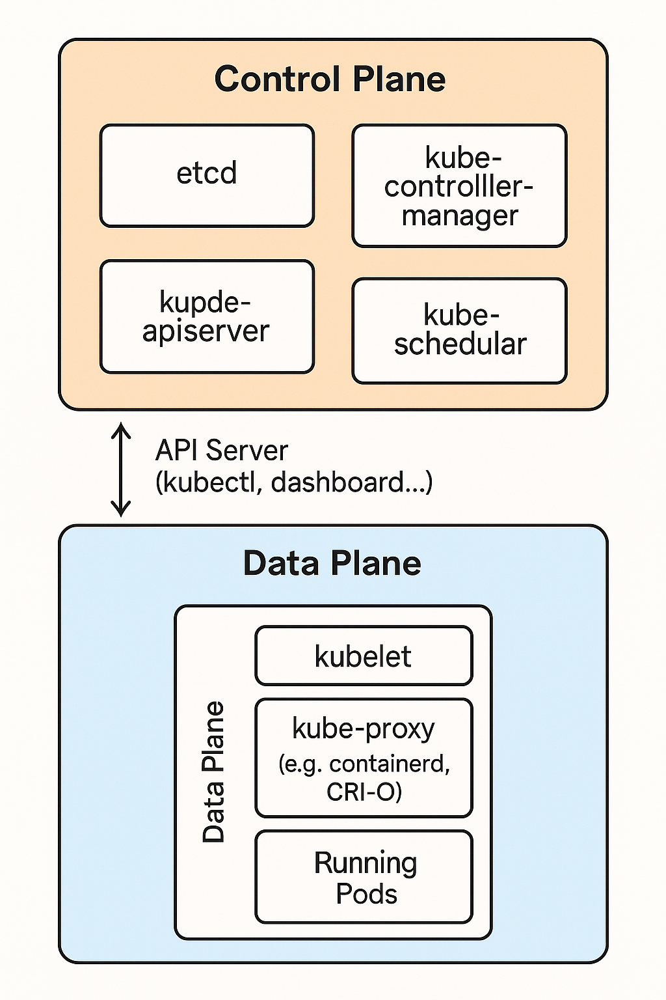

Le **control plane** (ou plan de contrôle) dans Kubernetes est l’ensemble des composants qui gèrent l’état global du cluster. C’est le **cerveau** du cluster Kubernetes : il prend les décisions concernant l'orchestration (ex. : planification des pods, réponse aux défaillances, déploiements, etc.) et assure la coordination des nœuds (nodes) qui exécutent réellement les conteneurs.

---

## ✨ Rôle principal

Le **control plane** maintient **l’état désiré du cluster** (défini par l’utilisateur via des objets comme Deployments, Services, etc.) et veille à ce que l’état actuel des ressources corresponde à cet état désiré.

---

## 🧩 Composants du Control Plane

Voici les composants principaux du control plane et leur rôle :

| Composant                  | Rôle                                                                                                                                                                                                  |
| -------------------------- | ----------------------------------------------------------------------------------------------------------------------------------------------------------------------------------------------------- |
| `kube-apiserver`           | Point d’entrée principal pour toute requête (CLI, UI, etc.). Il expose l’API Kubernetes (REST). C’est lui qui reçoit les commandes `kubectl`, valide les objets, et les écrit dans `etcd`.            |
| `etcd`                     | Base de données clé/valeur distribuée. C’est la **source de vérité** du cluster. Elle stocke toutes les configurations et l’état du cluster.                                                          |
| `kube-scheduler`           | Il décide sur **quel nœud** exécuter un pod en attente, en fonction des ressources disponibles, des contraintes, et des règles de placement.                                                          |
| `kube-controller-manager`  | Exécute les **contrôleurs** qui surveillent l’état du cluster et prennent des actions pour le rapprocher de l’état désiré. Exemple : `ReplicationController`, `NodeController`, `JobController`, etc. |
| `cloud-controller-manager` | Optionnel, utilisé pour interagir avec les services du cloud provider (load balancers, volumes, IPs…). Il est séparé du `kube-controller-manager`.                                                    |

---

## 📊 Schéma simplifié

```plaintext
                    +----------------------+
                    |    kube-apiserver    | <--- Entrée de l'API (kubectl, dashboard...)
                    +----------------------+
                               |
       +-----------------------+-------------------------+
       |                       |                         |
+---------------+     +---------------------+   +---------------------------+
|     etcd      |<--->| kube-controller-mgr |   |     kube-scheduler        |
+---------------+     +---------------------+   +---------------------------+
                                                      |
                                          (Choix du node pour exécuter un pod)
```

---

## 🖥️ Et les nodes ?

Le control plane **ne s’occupe pas directement de lancer les containers**. Ce sont les **nœuds de travail** (workers) qui font cela, via un agent local appelé `kubelet`. Le control plane donne les ordres, les workers les exécutent.

---

## 🔐 Disponibilité et haute tolérance

Dans un cluster de production, on déploie généralement **plusieurs instances du control plane** (master nodes) pour assurer la **haute disponibilité (HA)**.

---

## Résumé rapide

* 🧠 Le control plane pense et décide.
* 💽 `etcd` garde en mémoire l’état du cluster.
* ⚙️ `kube-scheduler` décide où placer les pods.
* 🔁 `kube-controller-manager` assure que tout fonctionne comme demandé.
* 📞 `kube-apiserver` est la porte d’entrée officielle.
* 💻 Les nodes exécutent les conteneurs, pas le control plane.

---

Souhaites-tu un schéma visuel ou une explication spécifique (ex : comment le scheduler place un pod) ?

Le **data plane** (ou plan de données) dans Kubernetes est la **partie du cluster qui exécute réellement les conteneurs**. Contrairement au **control plane**, qui décide **quoi faire**, le **data plane** exécute les tâches demandées.

---

## 🧩 Définition simple

> Le **data plane**, ce sont les **nœuds de travail (workers)** + les composants qui **lancent, surveillent, et exécutent** les conteneurs et leurs ressources réseau/stockage.

---

## 📦 Composants du Data Plane (par nœud)

Chaque **worker node** dans Kubernetes fait partie du data plane et contient généralement les composants suivants :

| Composant           | Rôle                                                                                                                                                                                     |
| ------------------- | ---------------------------------------------------------------------------------------------------------------------------------------------------------------------------------------- |
| `kubelet`           | Agent principal du nœud. Il communique avec le control plane (via l’API server) et s’assure que les pods sont en bon état sur le nœud. Il lance les conteneurs via le container runtime. |
| `container runtime` | Logiciel qui exécute les conteneurs. Exemples : **containerd**, **CRI-O**, ou (plus anciennement) **Docker**.                                                                            |
| `kube-proxy`        | Gère le **réseau** sur le nœud. Il met en place les règles pour que les pods puissent communiquer entre eux et avec l’extérieur (via Services).                                          |
| (Pods)              | Ce sont les unités d’exécution. Chaque pod contient un ou plusieurs conteneurs. C’est ce qui fait tourner vos applications.                                                              |

---

## 🖥️ Exemple de nœud worker (data plane)

```plaintext
+-------------------------------------+
|        Worker Node (Data Plane)     |
|                                     |
|  +-----------------------------+    |
|  |        kubelet              |    |  <-- Gère les pods sur ce nœud
|  +-----------------------------+    |
|  |        kube-proxy           |    |  <-- Réseau pour les pods
|  +-----------------------------+    |
|  |   container runtime (e.g.   |    |  <-- Lancement des conteneurs
|  |     containerd, CRI-O)      |    |
|  +-----------------------------+    |
|  |     Running Pods & Volumes  |    |  <-- Vos applications
|  +-----------------------------+    |
+-------------------------------------+
```

---

## ⚙️ Cycle de vie simplifié (exécution d'un pod)

1. L'utilisateur crée un `Deployment` via `kubectl`.
2. Le `kube-apiserver` enregistre ça dans `etcd`.
3. Le **scheduler** choisit un nœud (dans le data plane).
4. Le **kubelet** sur ce nœud reçoit la tâche.
5. Le **container runtime** télécharge l’image et démarre le conteneur.
6. Le **kube-proxy** configure les règles réseau pour le pod.

---

## 📊 Différence avec le Control Plane

| Élément               | Control Plane                                               | Data Plane                                       |
| --------------------- | ----------------------------------------------------------- | ------------------------------------------------ |
| Rôle                  | Décision et orchestration                                   | Exécution réelle des conteneurs                  |
| Où ?                  | Master nodes                                                | Worker nodes                                     |
| Principaux composants | `kube-apiserver`, `scheduler`, `controller-manager`, `etcd` | `kubelet`, `kube-proxy`, container runtime, pods |
| Exécution des apps    | ❌ Ne lance pas les conteneurs                               | ✅ Fait tourner les applications                  |

---

## En résumé

* Le **control plane** décide **quoi faire**.
* Le **data plane** **fait** ce qui est demandé.
* Le data plane tourne sur les **nœuds de travail** et contient les **pods**, donc vos **applications tournent là**.

Souhaites-tu un schéma global control/data plane ?


