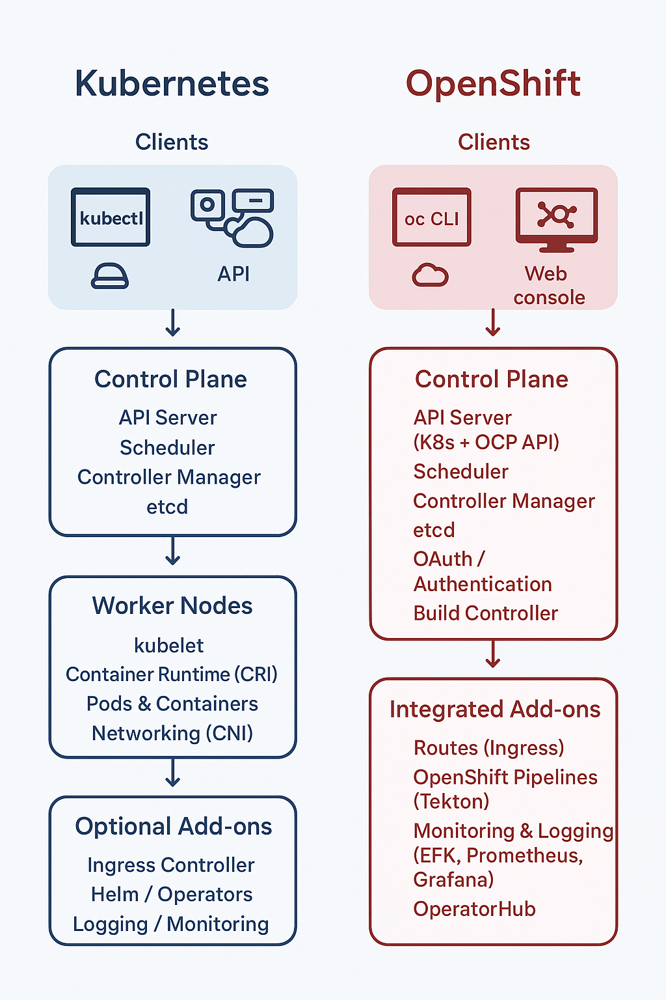

Bien sûr 👇 Voici une présentation claire et complète d’**OpenShift**, adaptée pour un développeur ou architecte cloud :

---

## 🧭 Qu’est-ce qu’OpenShift ?

**OpenShift** est une **plateforme de conteneurs** développée par **Red Hat**, basée sur **Kubernetes**, qui facilite le **déploiement, la gestion et la mise à l’échelle d’applications** conteneurisées.

👉 En résumé :

> **OpenShift = Kubernetes + outils DevOps + sécurité + intégration continue + expérience développeur améliorée**

---

## ⚙️ Composants clés

| Couche                    | Description                                                                                |
| ------------------------- | ------------------------------------------------------------------------------------------ |
| **Kubernetes**            | Le moteur d’orchestration de conteneurs (plan de contrôle, pods, services, etc.)           |
| **CRI-O / Docker**        | Le runtime de conteneurs                                                                   |
| **OpenShift API Server**  | Interface REST qui gère les objets OpenShift (BuildConfig, DeploymentConfig, Routes, etc.) |
| **Source-to-Image (S2I)** | Permet de construire automatiquement une image à partir d’un code source et d’un runtime   |
| **Routes / Ingress**      | Mécanisme d’exposition des services vers l’extérieur                                       |
| **Operators**             | Extensions Kubernetes gérant des applications complexes                                    |
| **OC CLI**                | Ligne de commande `oc` (analogue à `kubectl` avec des extensions OpenShift)                |
| **Web Console**           | Interface graphique complète pour déployer et gérer les applications                       |

---

## 🧩 Différences entre OpenShift et Kubernetes

| Aspect                      | Kubernetes                                | OpenShift                                        |
| --------------------------- | ----------------------------------------- | ------------------------------------------------ |
| **Installation**            | À la main ou via des outils comme kubeadm | Installation intégrée via `openshift-install`    |
| **Interface Web**           | Basique (Dashboard)                       | Complète et intégrée                             |
| **Authentification & RBAC** | De base                                   | SSO, LDAP, OAuth intégrés                        |
| **CI/CD**                   | À intégrer (ArgoCD, Tekton, etc.)         | Intégré (Tekton + S2I)                           |
| **Sécurité**                | Configuration manuelle                    | Politiques SELinux, SCC, et images signées       |
| **Multitenant**             | Limité                                    | Très bien géré (namespaces isolés, quotas, etc.) |

---

## 🏗️ Architecture simplifiée

```
+-------------------------------------------------------------+
|                  OpenShift Cluster                          |
|-------------------------------------------------------------|
|  Master Nodes  | API Server | Controller | Scheduler | etcd |
|-------------------------------------------------------------|
|  Worker Nodes  | Kubelet | CRI-O | SDN | Pods | Builds      |
|-------------------------------------------------------------|
|  Dev Tools     | Web Console | OC CLI | Pipelines | GitOps   |
+-------------------------------------------------------------+
```

---

## 🚀 Fonctions majeures

### 1. **Builds et Déploiement automatisé**

* **Source-to-Image (S2I)** : compile automatiquement le code (Java, Node.js, Python, etc.) en image exécutable.
* **BuildConfig & DeploymentConfig** : définissent comment construire et déployer une application.

### 2. **Pipelines CI/CD intégrés**

* Basé sur **Tekton**, pour créer des workflows CI/CD déclaratifs en YAML.

### 3. **Sécurité et conformité**

* **Security Context Constraints (SCC)** : empêche l’exécution de conteneurs privilégiés.
* **Image Signing & Policy** : vérifie la provenance des images.
* Intégration avec LDAP, OAuth, SSO.

### 4. **Observabilité intégrée**

* **Prometheus + Grafana** : monitoring.
* **Elasticsearch + Fluentd + Kibana (EFK)** : logs centralisés.

### 5. **Haute disponibilité et Scalabilité**

* Auto-scaling horizontal (HPA) et vertical.
* Clusters multi-zones, load balancing intégré.

---

## 🧱 Versions principales

| Produit                                | Description                                                              |
| -------------------------------------- | ------------------------------------------------------------------------ |
| **OpenShift Container Platform (OCP)** | Version commerciale, supportée par Red Hat                               |
| **OKD**                                | Version communautaire et open source (OpenShift Kubernetes Distribution) |
| **OpenShift Online**                   | Version SaaS hébergée par Red Hat                                        |
| **OpenShift Dedicated**                | Cluster OpenShift managé sur AWS/GCP/Azure                               |

---

## 💡 Cas d’usage typiques

* Déploiement d’applications **microservices**.
* Mise en place de **pipelines CI/CD** internes.
* Plateforme **DevSecOps** avec sécurité intégrée.
* Migration d’applications legacy vers des conteneurs.
* Hébergement d’**API, frontends, et workloads IA/ML**.

---

## 🧰 Exemple de workflow développeur

1. Le développeur **push** son code sur Git.
2. OpenShift **déclenche un build S2I** et **crée une image**.
3. L’image est stockée dans le **registry intégré**.
4. Un **DeploymentConfig** déploie l’application sur le cluster.
5. Une **Route** expose le service à l’extérieur.

👉 Tout cela se fait **automatiquement**, souvent sans toucher à Kubernetes directement.

---

## 📦 Exemple de commandes utiles

```bash
# Connexion
oc login https://api.mycluster:6443 --token=...

# Lister les projets (namespaces)
oc get projects

# Créer un nouveau projet
oc new-project demo-app

# Déployer une app depuis un repo Git
oc new-app https://github.com/sclorg/nodejs-ex.git

# Exposer le service
oc expose svc/nodejs-ex
```

---

## 🧠 En résumé

| Avantage                   | Détail                                     |
| -------------------------- | ------------------------------------------ |
| 🔒 Sécurité intégrée       | SELinux, SCC, OAuth                        |
| ⚙️ Automatisation          | Builds, déploiements, pipelines            |
| 🧩 Extensible              | Operators, Helm, Custom Resources          |
| 🧑‍💻 Facile pour les devs | Web console, S2I, GitOps                   |
| ☁️ Multi-cloud             | Fonctionne sur AWS, Azure, GCP, bare-metal |

---

Souhaitez-vous que je te fasse ensuite :

* ou une **comparaison détaillée entre OpenShift et Kubernetes “pur”** pour un usage entreprise ?

Parfait 👌 Voici une **comparaison détaillée entre OpenShift et Kubernetes**, structurée pour comprendre les différences **techniques, organisationnelles et stratégiques** entre les deux — notamment dans un contexte **entreprise** ou **DevOps**.

---

## 🧭 Vue d’ensemble

| Aspect       | **Kubernetes (K8s)**                | **OpenShift (OCP / OKD)**                                     |
| ------------ | ----------------------------------- | ------------------------------------------------------------- |
| **Nature**   | Projet open source géré par la CNCF | Distribution commerciale de Kubernetes développée par Red Hat |
| **Objectif** | Orchestrer les conteneurs           | Fournir une plateforme DevOps complète basée sur Kubernetes   |
| **Licence**  | Apache 2.0 (gratuit, open source)   | OCP : commerciale (support Red Hat) ; OKD : open source       |
| **Cible**    | Administrateurs et ingénieurs infra | Équipes Dev + Ops + Sécurité (DevSecOps)                      |

---

## ⚙️ 1. Installation et gestion du cluster

| Critère                  | **Kubernetes**                                                                   | **OpenShift**                                                         |
| ------------------------ | -------------------------------------------------------------------------------- | --------------------------------------------------------------------- |
| **Installation**         | Manuelle (kubeadm, Kops, Kubespray, etc.) ou via cloud providers (EKS, GKE, AKS) | Guidée via `openshift-install` ou managée (OpenShift Dedicated, ROSA) |
| **Complexité initiale**  | Moyenne à élevée                                                                 | Faible : automatisée, intégrée                                        |
| **Mises à jour**         | À faire soi-même                                                                 | Gestion automatisée des upgrades via l’Operator Hub                   |
| **Haute disponibilité**  | À configurer manuellement                                                        | Intégrée par défaut                                                   |
| **Air-Gapped (offline)** | Difficile                                                                        | Support complet avec mirroring d’images                               |

🟩 **Conclusion :** OpenShift simplifie fortement le **cycle de vie du cluster** (installation, mises à jour, patchs, sécurité).

---

## 🧑‍💻 2. Expérience développeur

| Critère                       | **Kubernetes**                                         | **OpenShift**                                                     |
| ----------------------------- | ------------------------------------------------------ | ----------------------------------------------------------------- |
| **Interface Web**             | Kubernetes Dashboard (limité, non sécurisé par défaut) | Console Web riche : monitoring, CI/CD, déploiement, logs          |
| **CLI**                       | `kubectl`                                              | `oc` (inclut toutes les commandes kubectl + extensions OpenShift) |
| **Builds automatiques (S2I)** | Non natif (à intégrer avec Jenkins, Tekton)            | Intégré : Source-to-Image, BuildConfigs                           |
| **Templates**                 | Helm charts                                            | Helm + Templates OpenShift                                        |
| **GitOps**                    | À installer (ArgoCD, FluxCD)                           | Intégré via OpenShift GitOps (ArgoCD)                             |
| **Registry**                  | À déployer (Harbor, Docker Hub, etc.)                  | Interne et sécurisé (OpenShift Image Registry)                    |

🟩 **Conclusion :** OpenShift offre une **expérience développeur clé en main**, sans dépendre d’outils externes.

---

## 🧱 3. Sécurité et conformité

| Critère                   | **Kubernetes**                               | **OpenShift**                                          |
| ------------------------- | -------------------------------------------- | ------------------------------------------------------ |
| **Politique de sécurité** | Basique, permissive par défaut               | Sécurité renforcée (SCC, SELinux, Policy Engine)       |
| **Exécution en root**     | Possible (souvent par défaut)                | Interdit par défaut                                    |
| **Authentification**      | Basique (certificats, RBAC, ServiceAccounts) | OAuth2, LDAP, SSO, IdP externes (Keycloak, AD, GitHub) |
| **Audit et logging**      | À configurer                                 | Activé et centralisé                                   |
| **Compliance**            | Non certifié                                 | Certifié FedRAMP, ISO, PCI, SOC 2 selon version        |

🟩 **Conclusion :** OpenShift est beaucoup plus **sécurisé par conception**, ce qui réduit les risques dans les environnements sensibles (banque, santé, défense, etc.).

---

## 🚀 4. CI/CD et automatisation

| Critère          | **Kubernetes**                                            | **OpenShift**                                                         |
| ---------------- | --------------------------------------------------------- | --------------------------------------------------------------------- |
| **Pipelines**    | Externe (Jenkins, GitHub Actions, Tekton, Argo Workflows) | Natif : OpenShift Pipelines (Tekton)                                  |
| **Triggers Git** | À configurer via webhook                                  | Intégrés (BuildConfig + Webhooks Git)                                 |
| **Rollouts**     | Via Deployments                                           | Via DeploymentConfig (avec stratégies de rolling, blue/green, canary) |
| **Operators**    | Support natif                                             | OperatorHub intégré avec UI et gestion de cycle de vie                |

🟩 **Conclusion :** OpenShift intègre une chaîne **DevOps complète**, tandis que Kubernetes nécessite l’ajout d’outils tiers.

---

## 🌐 5. Réseau et exposition

| Critère                               | **Kubernetes**                                           | **OpenShift**                              |
| ------------------------------------- | -------------------------------------------------------- | ------------------------------------------ |
| **Ingress**                           | Natif mais à configurer (Ingress Controller à installer) | “Route” intégrée (abstraction d’Ingress)   |
| **CNI (Container Network Interface)** | Pluggable (Calico, Flannel, Cilium)                      | OpenShift SDN ou OVN-Kubernetes            |
| **LoadBalancer**                      | Dépend du cloud provider                                 | Intégré (via Routes et Ingress Controller) |

🟩 **Conclusion :** OpenShift simplifie la **publication d’applications** et la **gestion réseau**.

---

## 🔍 6. Observabilité

| Critère        | **Kubernetes**                     | **OpenShift**                                       |
| -------------- | ---------------------------------- | --------------------------------------------------- |
| **Monitoring** | Prometheus, Grafana à installer    | Stack intégrée Prometheus + Alertmanager + Grafana  |
| **Logs**       | Fluentd / Loki à déployer          | Stack EFK (Elasticsearch, Fluentd, Kibana) intégrée |
| **Tracing**    | OpenTelemetry ou Jaeger à intégrer | Jaeger disponible via Operator                      |

🟩 **Conclusion :** OpenShift offre un **monitoring prêt à l’emploi**, tandis que Kubernetes demande plus d’intégration manuelle.

---

## 💰 7. Support et coûts

| Critère              | **Kubernetes**                                | **OpenShift**                                                |
| -------------------- | --------------------------------------------- | ------------------------------------------------------------ |
| **Support**          | Communautaire (GitHub, Slack, Stack Overflow) | Professionnel via Red Hat (24/7)                             |
| **Coût licence**     | Gratuit                                       | Payant (OCP), gratuit pour OKD                               |
| **TCO (coût total)** | Faible à court terme                          | Moindre à long terme (intégration, sécurité, support inclus) |

🟩 **Conclusion :** Kubernetes est **moins cher** au départ, mais OpenShift peut être **plus rentable** en entreprise (moins de maintenance, moins d’outils externes à gérer).

---

## 🧰 8. Extensibilité

| Critère              | **Kubernetes**       | **OpenShift**                        |
| -------------------- | -------------------- | ------------------------------------ |
| **CRDs / Operators** | Oui                  | Oui, avec OperatorHub intégré        |
| **Helm**             | Supporté             | Supporté (avec sécurité renforcée)   |
| **API REST**         | Oui (Kubernetes API) | Oui, superset avec API OpenShift     |
| **Compatibilité**    | Universelle          | Compatible avec K8s + extensions OCP |

🟩 **Conclusion :** OpenShift est **100 % compatible avec Kubernetes**, mais enrichi.

---

## 🧭 9. Versions et maintenance

| Critère              | **Kubernetes**    | **OpenShift**                                     |
| -------------------- | ----------------- | ------------------------------------------------- |
| **Cycle de version** | Tous les 3 mois   | Tous les 6 à 9 mois (basé sur version K8s stable) |
| **Support LTS**      | ~1 an par version | Jusqu’à 4 ans (versions étendues Red Hat)         |

🟩 **Conclusion :** OpenShift offre un **cycle de support long**, utile pour les grandes entreprises.

---

## 🧩 10. Usage typique

| Scénario                                          | Recommandé                                     |
| ------------------------------------------------- | ---------------------------------------------- |
| Sandbox, R&D, startup                             | **Kubernetes (GKE, EKS, AKS, Minikube)**       |
| Entreprise régulée, besoin de support et sécurité | **OpenShift (OCP, ROSA, OpenShift Dedicated)** |
| Équipes DevOps souhaitant une plateforme intégrée | **OpenShift**                                  |
| Infrastructure cloud-native custom                | **Kubernetes**                                 |

---

## 🧠 Résumé global

| Thème                      | Gagnant           |
| -------------------------- | ----------------- |
| Installation & Maintenance | 🟢 **OpenShift**  |
| Sécurité                   | 🟢 **OpenShift**  |
| Expérience Dev             | 🟢 **OpenShift**  |
| Flexibilité                | 🟢 **Kubernetes** |
| Coût initial               | 🟢 **Kubernetes** |
| Support entreprise         | 🟢 **OpenShift**  |

---

## 🧩 En une phrase

> **Kubernetes** est une boîte à outils.
> **OpenShift** est une plateforme prête à l’emploi, sécurisée et intégrée autour de Kubernetes.

---

Souhaites-tu que je t’en fasse maintenant une **comparaison architecturale schématisée** (diagrammes d’architecture Kubernetes vs OpenShift, avec les composants principaux) ?
Cela permet de **visualiser clairement les couches et différences structurelles**.

Parfait ! Voici une **comparaison architecturale schématisée** entre **Kubernetes “pur”** et **OpenShift**, pour visualiser clairement les composants et différences principales.

---

## 1️⃣ Architecture Kubernetes (vanille)

```
                ┌─────────────────────────┐
                │       Clients           │
                │  kubectl / Dashboard    │
                └─────────┬──────────────┘
                          │
                          ▼
                ┌─────────────────────────┐
                │      Control Plane      │
                │-------------------------│
                │  API Server             │
                │  Scheduler              │
                │  Controller Manager     │
                │  etcd (state store)     │
                └─────────┬──────────────┘
                          │
                          ▼
                ┌─────────────────────────┐
                │       Worker Nodes       │
                │-------------------------│
                │  kubelet                 │
                │  Container Runtime (CRI) │
                │  Pods & Containers       │
                │  Networking (CNI)        │
                └─────────┬──────────────┘
                          │
                          ▼
                ┌─────────────────────────┐
                │ Optional Add-ons         │
                │  Ingress Controller      │
                │  Helm / Operators        │
                │  Logging / Monitoring    │
                └─────────────────────────┘
```

**Points clés :**

* Kubernetes fournit l’orchestration mais nécessite **des composants supplémentaires** pour CI/CD, logs, monitoring, sécurité avancée.
* L’expérience développeur n’est pas intégrée ; tout se fait via `kubectl`, dashboards limités ou outils externes.

---

## 2️⃣ Architecture OpenShift

```
                ┌─────────────────────────────┐
                │         Clients              │
                │  oc CLI / Web Console / API  │
                └──────────────┬──────────────┘
                               │
                               ▼
                ┌─────────────────────────────┐
                │       Control Plane          │
                │-----------------------------│
                │  API Server (K8s + OCP API) │
                │  Scheduler                  │
                │  Controller Manager         │
                │  etcd                       │
                │  OAuth / Authentication     │
                │  Build Controller (S2I)     │
                └──────────────┬──────────────┘
                               │
                               ▼
                ┌─────────────────────────────┐
                │        Worker Nodes          │
                │-----------------------------│
                │  kubelet                     │
                │  CRI-O / Container Runtime   │
                │  Pods & Containers           │
                │  Networking (OpenShift SDN) │
                │  Image Registry              │
                └──────────────┬──────────────┘
                               │
                               ▼
                ┌─────────────────────────────┐
                │   Integrated Add-ons         │
                │  Routes (Ingress)            │
                │  OpenShift Pipelines (Tekton)│
                │  Monitoring & Logging (EFK, Prometheus, Grafana) │
                │  OperatorHub (app management) │
                └─────────────────────────────┘
```

**Points clés :**

* OpenShift ajoute une **couche DevOps complète**, intégrée au-dessus de Kubernetes.
* Sécurité renforcée (SCC, OAuth, SELinux), registry interne, pipelines CI/CD intégrés.
* L’expérience développeur est **prête à l’emploi**, pas besoin d’ajouter manuellement des outils.

---

## 3️⃣ Comparaison visuelle simplifiée

```
Kubernetes          OpenShift
─────────────       ──────────────
Control Plane        Control Plane
 ├ API Server          ├ API Server + OpenShift API
 ├ Scheduler           ├ Scheduler
 ├ Controller Mgmt     ├ Controller Mgmt + Build Controller
 └ etcd                └ etcd + OAuth/Auth

Worker Nodes          Worker Nodes
 ├ kubelet             ├ kubelet
 ├ CRI (Docker)        ├ CRI-O
 ├ Pods & Containers   ├ Pods & Containers
 └ Networking (CNI)    └ Networking (OpenShift SDN) + Image Registry

Add-ons               Add-ons (integrated)
 ├ Ingress             ├ Routes / Ingress
 ├ Helm / Operators    ├ OperatorHub
 ├ Monitoring / Logs   ├ Monitoring + Logging (EFK, Prometheus, Grafana)
 └ CI/CD               └ OpenShift Pipelines (Tekton) + S2I
```

**Synthèse :**

* **Kubernetes = boîte à outils flexible** mais nécessite de l’assemblage.
* **OpenShift = plateforme clé en main** avec DevOps, sécurité et observabilité intégrés.
* OpenShift est 100% compatible Kubernetes, donc tout ce qui fonctionne sur K8s fonctionne aussi sur OCP/OKD.

---

Si tu veux, je peux te créer **un diagramme graphique coloré et moderne** comparant les deux architectures pour que ce soit **prêt à mettre dans une présentation ou un rapport**.

Veux‑tu que je fasse ça ?


